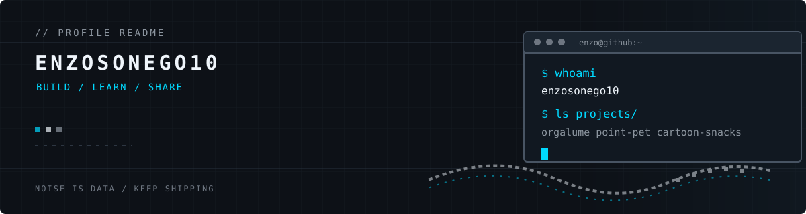

  

 

# Oi, eu sou o Enzo 👋

### Projetos web, ideias simples e código que evolui.

`HTML` · `JavaScript` · `PHP`

---

## `01` / sobre mim

Este perfil reúne projetos web, experimentos de interface e ideias que saíram do papel. Aqui eu registro o que estou construindo e explorando em cada repositório.

> **status:** em construção contínua

---

## `02` / projetos em destaque

<table>
  <tr>
    <td width="50%" valign="top">
      <h3>OrgaLume</h3>
      
Painel pessoal para organizar tarefas, agenda, projetos e notas.

      <a href="https://github.com/enzosonego10/orgalume">ver repositório →</a>
    </td>
    <td width="50%" valign="top">
      <h3>Point Pet</h3>
      
Mapa colaborativo de locais que recebem pets.

      <a href="https://github.com/enzosonego10/point-pet">ver repositório →</a>
    </td>
  </tr>
  <tr>
    <td width="50%" valign="top">
      <h3>Cartoon Snacks</h3>
      
Projeto visual inspirado em uma franquia de alimentos e desenhos.

      <a href="https://github.com/enzosonego10/Cartoon-Snacks">ver repositório →</a>
    </td>
    <td width="50%" valign="top">
      <h3>Manutenção da Escola Agrícola</h3>
      
Sistema para registrar e acompanhar pedidos de manutenção.

      <a href="https://github.com/enzosonego10/manutencao-da-escola-agricola">ver repositório →</a>
    </td>
  </tr>
</table>

---

## `03` / stack

  

---

## `04` / conecte-se

  

---

## `05` / atividade

  
  

 

  

---

  feito com curiosidade, prática e commits pequenos.

